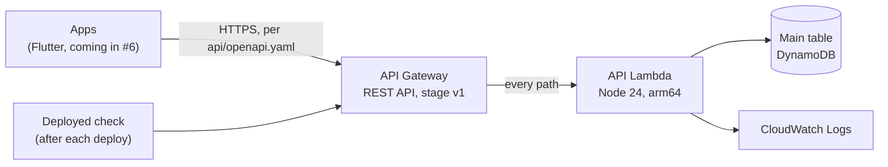

# Architecture

This page shows what's built so far. It grows as each ticket adds to the system; the full v1 plan is in the spec (issue #3) and the reasoning in [`adr/`](adr/).

Everything runs in `us-west-2` ([ADR 0006](adr/0006-single-region-us-west-2.md)), with one CloudFormation stack per stage: `dc-dev`, `dc-staging`, `dc-prod`.

## The API

- **One contract.** [`api/openapi.yaml`](../api/openapi.yaml) describes every operation. The apps' Dart client will be generated from it (#6). Every API test checks responses against it, and a path it doesn't describe must return its `Error` response with a 404.
- **One Lambda.** API Gateway sends every request to a single API Lambda, which routes by method and path (`backend/src/app.ts`). Adding an operation means adding a route and documenting it in the OpenAPI definition. Scheduled jobs, Step Functions steps and the Assistant will get their own functions that reuse the same app code ([ADR 0009](adr/0009-one-lambda-serves-the-whole-api.md)).
- **Dependencies are passed in.** The app is built from its dependencies (`createApp({ clock, db, tableName })`). The Lambda passes the real ones; tests pass DynamoDB Local and fakes.
- **Time comes from the `Clock`.** Business rules call `clock.now()`, never `new Date()`, so tests can set the time.

## Data

One main DynamoDB table with a generic `PK`/`SK` key holds the operational data. The key layout for each record is designed per ticket, once its queries are known. In staging and production the table is retained if the stack is deleted, with point-in-time recovery and deletion protection on. Dev has neither, since it only holds made-up data.

## Stages

Each stage's settings live in `backend/infra/stage.ts`. The account comes from the AWS profile used to deploy, so staging and production are created the same way as dev, each in its own account.

## Tests

| Group | Command | What it checks |
|---|---|---|
| `api` | `npm test` | The API through the real handler, in-process, against DynamoDB Local in Docker. Responses are checked against OpenAPI. |
| `infra` | `npm test` | Each stage can be built from settings alone, in `us-west-2` |
| `deployed` | `npm run check:deployed` | A deployed stage answers `/health` and can read its table |

Fakes for outside systems are added only when a ticket first needs them. So far there's one: the clock (`backend/test/support/fakeClock.ts`).
