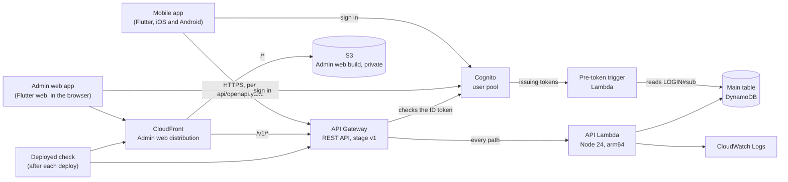

# Architecture

This page shows what's built so far. It grows as each ticket adds to the system; the full v1 plan is in the spec (issue #3) and the reasoning in [`adr/`](adr/).

Every API path needs a Cognito ID token, checked by API Gateway, except `GET /health`.

Everything runs in `us-west-2` ([ADR 0006](adr/0006-single-region-us-west-2.md)), with one CloudFormation stack per stage: `dc-dev`, `dc-staging`, `dc-prod`.

## The API

- **One contract.** [`api/openapi.yaml`](../api/openapi.yaml) describes every operation. The apps' Dart client in `packages/api_client` is generated from it by `packages/generate-api-client.sh` (openapi-generator's `dart` generator, run in Docker) and committed. Every API test checks responses against it, and a path it doesn't describe must return its `Error` response with a 404 to a signed-in request. Without a valid token, API Gateway answers every path except `GET /health` with 401 before the API sees it.
- **One Lambda.** API Gateway sends every request to a single API Lambda, which routes by method and path (`backend/src/app.ts`). Adding an operation means adding a route and documenting it in the OpenAPI definition. Scheduled jobs, Step Functions steps and the Assistant will get their own functions that reuse the same app code ([ADR 0009](adr/0009-one-lambda-serves-the-whole-api.md)).
- **Dependencies are passed in.** The app is built from its dependencies (`createApp({ clock, db, tableName })`). The Lambda passes the real ones; tests pass DynamoDB Local and fakes.
- **Time comes from the `Clock`.** Business rules call `clock.now()`, never `new Date()`, so tests can set the time.
- **Who's asking comes from the token's claims.** Cognito handles login only. Once a login has signed up (`PUT /me`), Cognito's pre-token-generation trigger (`backend/src/preTokenGeneration.ts`, its own Lambda) reads `LOGIN#` and adds a `personId` claim to the ID and access tokens, so the app refreshes its tokens after signing up. Roles never go in tokens. API Gateway's Cognito authorizer checks the token and passes its claims, and the API reads them in `backend/src/auth.ts`. Each route says who may call it by wrapping its handler in `signedIn`, `signedUp`, `orgOwner` or `centerOwner` (`backend/src/access.ts`). `centerOwner` reads the Center's profile and checks the person owns the Organization it names. A request without claims gets a 401. A login whose token has no `personId` claim hasn't signed up yet (`PUT /me`) and gets a 403 everywhere else. Roles live in DynamoDB, and access checks read them with strongly consistent reads. An Organization a person doesn't own answers 404, so nobody learns which ones exist. MFA is optional for everyone for now (#51).
- **Keys come from one module.** Every main-table key is built in `backend/src/keys.ts`, which can't build a Center key without a Center ID (ADR 0010).
- **Creates are safe to retry.** Records created in the apps carry a device-made ULID, checked in `backend/src/ids.ts`. A create stores a hash of its request and its result (`backend/src/idempotency.ts`). The same request again gets the original result, and a different request with the same ID gets a 409. Every item records who saved it, when, and through what (`backend/src/records.ts`).
- **Changes keep history.** A record that can be corrected, such as a Center's profile, is changed in one transaction that adds the next history item and replaces the head only if it's still at the version the change expects (`replaceIfVersion` in `backend/src/idempotency.ts`). A change made against an old version gets a 409. A retry of the same change finds its hash on that history item and gets the original result. Changing a Center's timezone leaves records already saved with the dates they had.
- **Errors are logged with the operation's name,** such as `POST /organizations`, in `backend/src/app.ts` (ADR 0009).

## The apps

- **Mobile** (`apps/mobile`): one Flutter app for Staff and Guardians. It calls API Gateway directly, at the URL given with `--dart-define=API_URL=…` at build time.
- **Admin web** (`apps/admin_web`): a Flutter web app. Its build is uploaded on deploy to a private S3 bucket that blocks all public access. Only the stage's CloudFront distribution can read it, through Origin Access Control.
- **The API on the same address.** The Admin web distribution also passes `/v1/*` to API Gateway, uncached. The web app calls its own origin, so the API needs no CORS and no list of allowed origins.
- **Shared code.** Both apps use the generated client and the shared UI library in `packages/ui`, which holds the theme and shared screens.

## Data

One main DynamoDB table with a generic `PK`/`SK` key holds the operational data. [`data-model.md`](data-model.md) lists every v1 query and the key layout that serves them. Every Center record's key starts with the Center, corrected records keep append-only history, and records are ready for offline use (ADR 0004). Analytics will use a daily DynamoDB export to S3, read with Athena (#42), which needs point-in-time recovery in dev too. In staging and production the table is retained if the stack is deleted, with point-in-time recovery and deletion protection on. Dev has neither, since it only holds made-up data.

## Stages

Each stage's settings live in `backend/infra/stage.ts`. The account comes from the AWS profile used to deploy, so staging and production are created the same way as dev, each in its own account.

## Tests

| Group | Command | What it checks |
|---|---|---|
| `api` | `npm test` | The API through the real handler, in-process, against DynamoDB Local in Docker. Responses are checked against OpenAPI. Cognito's triggers are called the way Cognito calls them (`test/triggers`). |
| `infra` | `npm test` | Each stage can be built from settings alone, in `us-west-2` |
| `infra` (Admin web) | `npm test` | The Admin web bucket is private and readable only by CloudFront, and `/v1/*` goes to the API, uncached |
| `infra` (logins) | `npm test` | The user pool signs in by email with optional authenticator-app MFA, the pre-token trigger runs as version 2 and can only read the table, and every API method except `GET /health` needs a Cognito login |
| `deployed` | `npm run check:deployed` | A deployed stage answers `/health` and can read its table, and refuses requests without a valid token. The Admin web app is served through CloudFront, its address reaches the API, and the bucket refuses direct requests |
| App screens | `flutter test` in each app | Each app's screens, with the real generated client talking to a fake API |

Fakes for outside systems are added only when a ticket first needs them. So far there's one: the clock (`backend/test/support/fakeClock.ts`).
